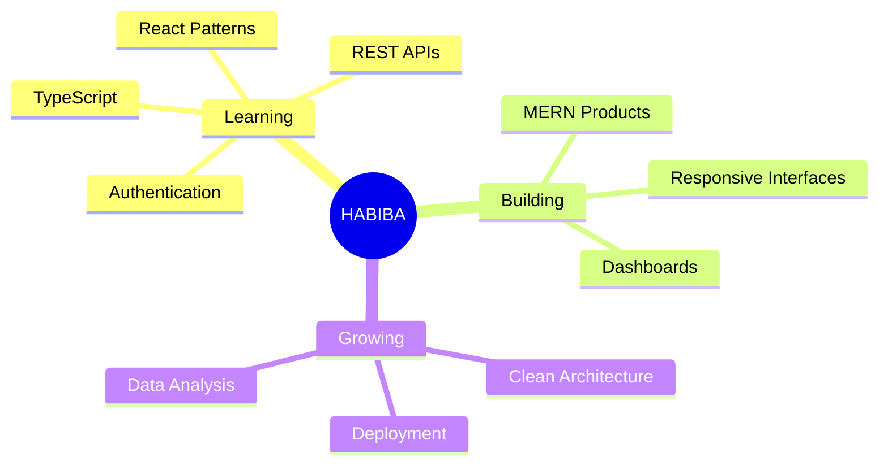

<!-- ✦ HABIBA NADEEM — NEON GALAXY PROFILE README ✦ -->

<div align="center">


<a href="https://git.io/typing-svg">
  
</a>

<br/><br/>

<a href="https://github.com/habibanadeemhere">
  
</a>
<a href="https://github.com/habibanadeemhere">
  
</a>
<a href="https://linkedin.com/in/habiba-nadeem-4b63412b9">
  
</a>
<a href="mailto:habibanadeem075@gmail.com">
  
</a>

</div>


<br/>

<div align="center">


</div>

<table>
<tr>
<td width="38%" align="center">

<br/><br/>

</td>
<td width="62%">

```js
╔══════════════════════════════════════╗
║           HABIBA.EXE                 ║
╠══════════════════════════════════════╣
║  ID        :: Full Stack Developer   ║
║  Location  :: Karachi, Pakistan 🇵🇰   ║
║  Academy   :: SMIT · Batch 16        ║
║  Stack     :: MERN + JavaScript      ║
║  Mission   :: Build meaningful apps  ║
║  Mode      :: Learn → Create → Ship  ║
╚══════════════════════════════════════╝

```

</td>
</tr>
</table>

<div align="center">

> **I don't just write code. I turn imagination into interfaces, logic into products, and problems into possibilities.**

</div>

---

<h2 align="center">⚡ THE WEAPONRY</h2>

<div align="center">


<br/><br/>


</div>

---

<h2 align="center">🚀 SELECTED MISSIONS</h2>

<div align="center">

<a href="https://github.com/habibanadeemhere/supportflow">
  
</a>
<a href="https://github.com/habibanadeemhere/3D-Portfolio">
  
</a>
<a href="https://github.com/habibanadeemhere/SMIT-Connect-Portal">
  
</a>
<a href="https://github.com/habibanadeemhere/Sales-Data-Analysis">
  
</a>

</div>

<br/>

<div align="center">

| Mission | Technology | Objective |
|:--|:--:|:--|
| 🛟 **SupportFlow** | MERN / JavaScript | Complete customer support platform |
| 🌌 **3D Portfolio** | JavaScript / CSS | Immersive visual developer identity |
| 🎓 **SMIT Connect** | JavaScript | Campus and student portal experience |
| 📊 **Sales Analysis** | Python | Turn raw data into useful insights |

</div>

---

<h2 align="center">📡 LIVE GITHUB TELEMETRY</h2>

<div align="center">


<br/><br/>


<br/><br/>


</div>

---

<h2 align="center">🧬 CURRENT LOADOUT</h2>

<div align="center">



</div>

---

<h2 align="center">📡 OPEN CHANNEL</h2>

<div align="center">

<a href="https://linkedin.com/in/habiba-nadeem-4b63412b9">
  
</a>
<a href="mailto:habibanadeem075@gmail.com">
  
</a>
<a href="https://github.com/habibanadeemhere">
  
</a>

<br/><br/>


**`[ DREAM ] [ CODE ] [ BUILD ] [ REPEAT ]`**

</div>
