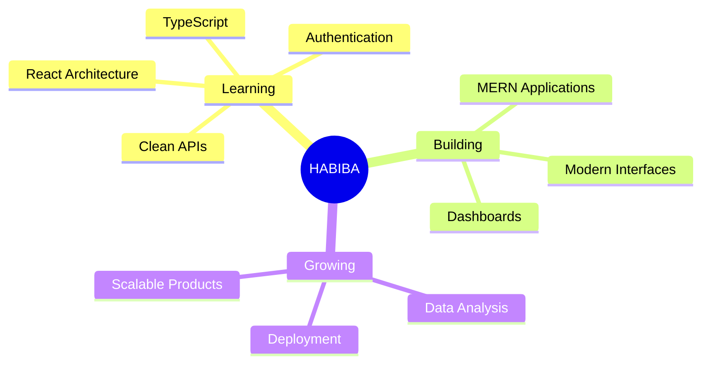

<div align="center">
  


[](https://git.io/typing-svg)

<br/>


<a href="https://github.com/habibanadeemhere"></a>
<a href="https://linkedin.com/in/habiba-nadeem-4b63412b9"></a>
<a href="mailto:habibanadeem075@gmail.com"></a>

</div>


<br/>

<!-- ═══════════════════════ IDENTITY ═══════════════════════ -->

<h2 align="center">◈  IDENTITY MATRIX  ◈</h2>

<table>
<tr>
<td width="34%" align="center">


<br/>


</td>
<td width="66%" valign="middle">

```javascript
/*
 *  █▀▀ █▀█ █▀▄ █▀▀
 *  █▄▄ █▄█ █▄▀ █▄▄
 *
 *  SUBJECT:  Habiba Nadeem
 *  CLASS:    Full-Stack MERN Developer
 *  BASE:     Karachi, Pakistan 🇵🇰
 *  TRAINING: SMIT — Batch 16
 *
 *  mission.execute({
 *    learn: "Every day",
 *    create: "Digital experiences",
 *    improve: "Without limits",
 *    ship: "Something meaningful"
 *  });
 */
```

</td>
</tr>
</table>

<div align="center">

> **“I build more than screens. I build experiences that people remember.”**

</div>

<br/>

<!-- ═══════════════════════ STATUS ═══════════════════════ -->

<h2 align="center">◈  LIVE STATUS  ◈</h2>

<div align="center">

<table>
<tr>
<td align="center">

### 01
**LOCATION**

Karachi, PK

</td>
<td align="center">

### 02
**TRAINING**

SMIT · Batch 16

</td>
<td align="center">

### 03
**PRIMARY STACK**

MERN

</td>
<td align="center">

### 04
**CURRENT MODE**

`BUILDING`

</td>
</tr>
</table>

</div>

<br/>

<!-- ═══════════════════════ ARSENAL ═══════════════════════ -->

<h2 align="center">◈  TECHNOLOGY ARSENAL  ◈</h2>

<div align="center">


<br/><br/>


</div>

<br/>

<!-- ═══════════════════════ MISSIONS ═══════════════════════ -->

<h2 align="center">◈  SELECTED MISSIONS  ◈</h2>

<div align="center">

<a href="https://github.com/habibanadeemhere/supportflow">

</a>

<a href="https://github.com/habibanadeemhere/3D-Portfolio">

</a>

<a href="https://github.com/habibanadeemhere/SMIT-Connect-Portal">

</a>

<a href="https://github.com/habibanadeemhere/Sales-Data-Analysis">

</a>

</div>

<br/>

<h3 align="center">MISSION FILES</h3>

| CODE | PROJECT | OBJECTIVE |
|:--:|:--|:--|
| `SFL-01` | **SupportFlow** | Complete customer support workflow |
| `P3D-02` | **3D Portfolio** | Immersive developer identity |
| `SMT-03` | **SMIT Connect** | Student and campus portal |
| `DAT-04` | **Sales Analysis** | Data-led visual intelligence |

<br/>

<!-- ═══════════════════════ TELEMETRY ═══════════════════════ -->

<h2 align="center">◈  LIVE TELEMETRY  ◈</h2>

<div align="center">


<br/><br/>


<br/><br/>


</div>

<br/>

<!-- ═══════════════════════ CURRENT DIRECTIVE ═══════════════════════ -->

<h2 align="center">◈  CURRENT DIRECTIVE  ◈</h2>

<div align="center">



</div>

<br/>

<!-- ═══════════════════════ CONNECT ═══════════════════════ -->

<h2 align="center">◈  OPEN COMMUNICATION CHANNEL  ◈</h2>

<div align="center">

<a href="https://github.com/habibanadeemhere">

</a>

<a href="https://linkedin.com/in/habiba-nadeem-4b63412b9">

</a>

<a href="mailto:habibanadeem075@gmail.com">

</a>

<br/><br/>


**`[ DREAM ] ━━━ [ CODE ] ━━━ [ BUILD ] ━━━ [ EVOLVE ]`**

</div>
